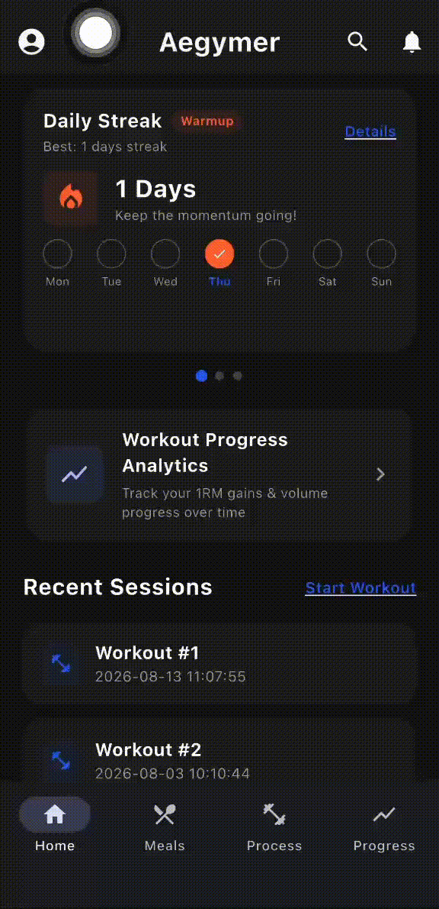
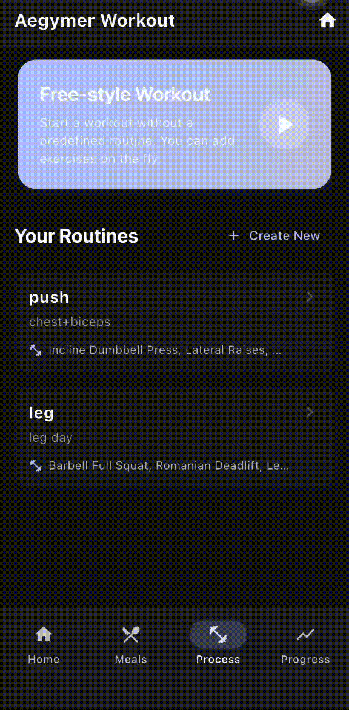
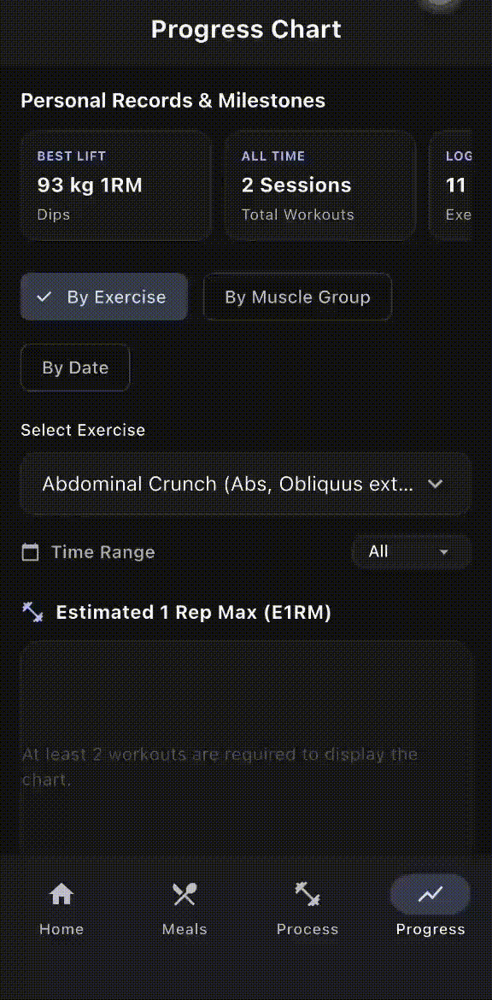
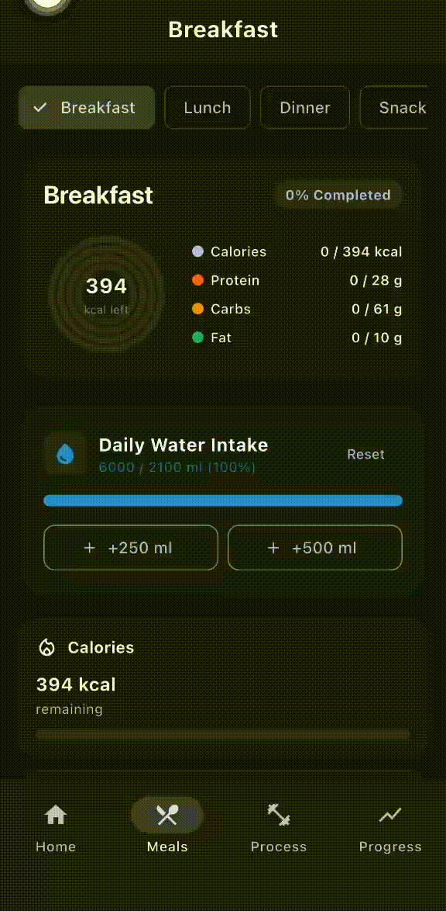

# Aegymer

[](https://github.com/felixilars/Aegymer/releases/latest)
[](https://flutter.dev)
[-10B981?style=flat-square)](https://drift.simonbinder.eu/)
[](#what-it-does)
[](#privacy)
[](LICENSE)

Personal fitness and nutrition tracking app built with Flutter. Workout logging, on-device machine learning autoregulation, auto-saved crash recovery, progressive overload analytics, and macro-based meal suggestions in one place, and everything runs offline.

The project is developed on [GitHub](https://github.com/felixilars/Aegymer). Releases and source code live here.

## Support

Questions, bug reports, and feature requests can be submitted through the
[GitHub issue tracker](https://github.com/felixilars/Aegymer/issues).
When filing a bug, include the app version, your device model, Android version, and the steps that reproduce the issue.

## Download

Grab the latest APK from the
[**Releases page**](https://github.com/felixilars/Aegymer/releases/latest) and
open it on your phone. Works on Android 5.0 (API 21) or newer.

Android will prompt that the file comes from outside Google Play. Allow the installation in your browser or file manager when asked; the APK is signed with the same release key for every version, so future updates install directly over the top without uninstalling first or losing your workout logs.

No account or sign-up is required. You do not need to provide an email, and all data stays strictly on your phone.

## Screenshots

<p align="center">
  
  
  
  
</p>

<p align="center"><sub>From left to right: Daily Dashboard & Streak, Active Workout Logging, Progress & PR Analytics, and Meal Planning.</sub></p>

## What it does

- **Workout Tracking** logs barbell exercises, dumbbell lifts, bodyweight sets (weighted or assisted), and cardio. Tracks weight, reps, distance, and duration with an automatic rest timer, plate calculator, and per-set calorie estimation.
- **On-Device Machine Learning & Autoregulation** uses a built-in K-Nearest Neighbors (KNN) regression model and the APRE protocol to dynamically prescribe working weights and reps for upcoming sessions. It analyzes Acute-to-Chronic Workload Ratio (ACWR), fatigue drop-off rates, and rest intervals to calculate progressive overload targets and detect deload needs—computed entirely on-device without any cloud dependencies.
- **Session Recovery** auto-saves active workout progress every 10 seconds and whenever the app is minimized, locked, or backgrounded. If the app closes or the battery runs out during your final set, opening the app presents an unfinished workout banner with options to resume where you left off or save directly to history with a single tap.
- **Workout History** gives you a full chronological list of every completed session. You can review past performance, edit sets/reps/weights in-place to correct mistakes, or delete duplicate sessions. Streak numbers and volume loads recalculate immediately.
- **Routine Editor** lets you build and save reusable training routines (e.g. Push, Pull, Legs) or start a free-style workout on the fly.
- **Nutrition & Smart Meal Engine** calculates your BMR and TDEE based on body metrics and activity level. It applies a multi-factor heuristic scoring algorithm (matching calories, macro proportions, and food variety) to recommend balanced meals tailored to your remaining daily allowance and current meal context (Breakfast, Lunch, Dinner, Snack). Includes OpenFoodFacts search and custom portion controls.
- **Progress & Analytics** tracks your volume load trends over time, calculates estimated one-rep maxes (e1RM), and breaks down volume across muscle groups (Chest, Back, Legs, Shoulders, Arms, Core).

The home screen provides a single daily hub showing your current workout streak, weekly target progress, active workout drafts, and your most recent sessions.

## Privacy

All data is stored locally on your device in an SQLite database using Drift. Your body weight, workout logs, routines, and meal entries never leave your device.

There are no remote accounts, no email requirements, no analytics SDKs, and no background tracking.

An export/import feature in the settings allows you to export your complete database to a JSON file at any time to back up or migrate to another device.

## Contributing

Contributions and pull requests are welcome! Please review [CONTRIBUTING.md](CONTRIBUTING.md) for guidelines on code style, branch naming, and the pull request submission process.

### Contributors

<a href="https://github.com/felixilars/Aegymer/graphs/contributors">
  
</a>

## Development

Requirements:

- Flutter SDK, stable channel `>=3.22.0`
- Dart SDK `^3.12.0`
- Android SDK (minSdk 21, targetSdk 34)

```bash
flutter pub get

# Run on connected device or emulator
flutter run
```

Static checks and tests:

```bash
flutter test
```

## Releasing

To build a release APK for Android:

```bash
# Bump version in pubspec.yaml (e.g., version: 1.0.1+2)
flutter build apk --release
```

The resulting file is located at `build/app/outputs/flutter-apk/app-release.apk`.

> **Note on Signing**: The release build uses `android/key.properties` and `android/app/upload-keystore.jks`. Never delete or lose this keystore file, as Android requires the same signature to install updates over existing installations.

## Project structure

```
Aegymer/
  lib/
    main.dart                  # App bootstrap and database initialization
    helper/
      check_firsttime.dart     # First-launch detection and safe update migration
    models/                    # Domain data models, macro calculations, DTOs
    core/
      databases/               # Drift SQLite schema, migrations, and companions
      services/                # Autoregulation (KNN ML), workout draft, backup, streak, nutrition
      repositories/            # Data access layer for food, meals, user profile
      utils/                   # 1RM calculation, calorie estimates, time helpers
      theme/                   # Design system tokens and light/dark theme
    presentation/
      AppBars/                 # Custom top navigation bars
      screen/
        Home_and_Main/         # Dashboard, streak cards, recent sessions
        MealPrep/              # Meal tracking, macro progress, food search
        UserProfile/           # Body metrics, target goals, preferences
        active_workout_screen.dart     # In-progress workout logger with auto-save
        edit_workout_session_screen.dart # Edit existing workout history records
        workout_history_screen.dart    # Full chronological workout history
        workout_launcher_screen.dart   # Routine selector & draft resumption
        workout_progress_screen.dart   # Progress charts & 1RM analytics
        welcome_screen.dart    # First-time onboarding introduction
      widgets/                 # Shared UI cards, sheets, and popups
```

## Data sources & Machine Learning

- **On-Device Machine Learning**: Built-in K-Nearest Neighbors (KNN) regression engine and APRE algorithms running locally for volume load and progressive overload modeling.
- **Exercise Database**: Local curated exercise dataset with target muscle groups and tracking types.
- **Nutrition Database**: Offline nutrition reference data integrated with the OpenFoodFacts API for extended food queries.
- **Local Storage**: Local SQLite database via [Drift](https://drift.simonbinder.eu/) with automatic schema migrations.

## License

This project is licensed under the [MIT License](LICENSE).
