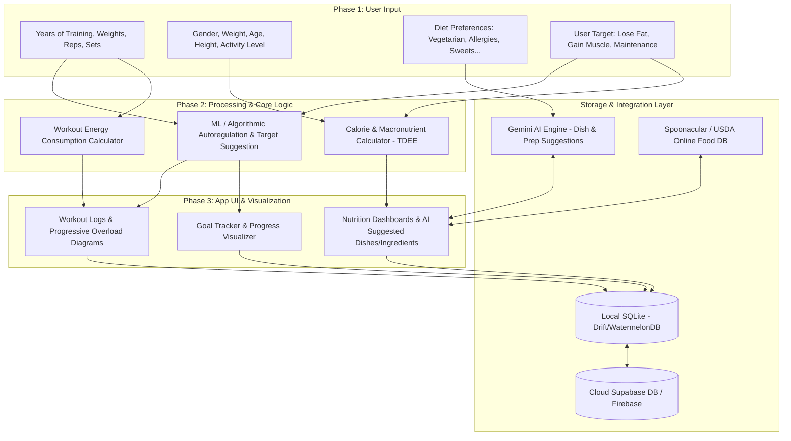
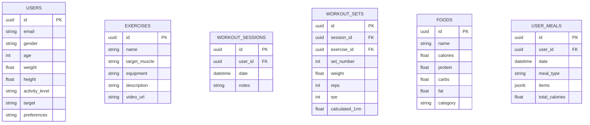

# Kế Hoạch Triển Khai: Gym & Nutrition Tracker App (Android/iOS)

Dự án này là một ứng dụng di động đa nền tảng (Android/iOS) hỗ trợ người dùng theo dõi quá trình tập luyện (Gym Tracker) và đề xuất dinh dưỡng cá nhân hóa (Nutrition Suggestion) sử dụng Trí tuệ Nhân tạo (AI/ML). 

Hệ thống sẽ ghi nhận lịch sử tập luyện, tính toán năng lượng tiêu hao, áp dụng phương pháp Tăng tiến Tải trọng (Progressive Overload) và Tự điều chỉnh (Autoregulation) để đề xuất mục tiêu tiếp theo. Song song đó, dựa vào thông tin thể trạng và sở thích ẩm thực (chay, ngọt, dị ứng...), ứng dụng sẽ đề xuất thực đơn và nguyên liệu nấu ăn phù hợp.

---

## User Review Required

> [!IMPORTANT]
> **Quyết định về Công nghệ cốt lõi & API:**
> 1. **Lựa chọn Framework Di động:** Đề xuất sử dụng **Flutter** (Dart) hoặc **React Native** (TypeScript). Chúng tôi khuyến nghị **Flutter** vì hiệu năng vẽ biểu đồ (Diagram) mượt mà và khả năng đồng bộ SQLite cục bộ rất tốt qua thư viện Drift.
> 2. **Nguồn Dữ liệu Foods & Exercises:** 
>    - **Exercises:** Sử dụng dữ liệu mở từ **Wger API** hoặc tự seeding một danh sách bài tập chuẩn (khoảng 300-500 bài tập cơ bản bằng tiếng Việt/Anh) vào cơ sở dữ liệu của app thay vì phụ thuộc hoàn toàn vào API bên thứ ba để đảm bảo tốc độ tải.
>    - **Foods/Nutrition:** Tích hợp **Spoonacular API** (rất mạnh về đề xuất món ăn từ nguyên liệu và lọc dị ứng/ăn chay) kết hợp với **Open Food Facts API** (miễn phí, cơ sở dữ liệu thực phẩm quét mã vạch lớn).
> 3. **Giải pháp AI/ML:** Sử dụng **Gemini 1.5 Flash API** để xử lý các yêu cầu đề xuất món ăn phức tạp theo cá nhân hóa, vì mô hình này nhanh, chi phí cực kỳ rẻ (hoặc miễn phí ở gói demo) và có khả năng trả về định dạng JSON chuẩn để ứng dụng parse trực tiếp sang UI.

---

## Open Questions

> [!WARNING]
> **Các câu hỏi cần làm rõ trước khi code:**
> 1. Bạn mong muốn phát triển ứng dụng bằng **Flutter (Dart)** hay **React Native (TypeScript/Expo)**?
> 2. Về thuật toán ML cho Autoregulation (Tự điều chỉnh cường độ tập): Bạn muốn áp dụng hệ thống tự động tăng/giảm Set/Rep/Weight dựa trên chỉ số **RPE (Rate of Perceived Exertion - Tỷ lệ cảm nhận gắng sức từ 1-10)** hay chỉ đơn thuần dựa trên việc hoàn thành đủ số Rep mục tiêu (ví dụ: nếu đạt 3 set x 10 rep thì buổi sau tự động tăng tạ)?
> 3. Bạn đã có tài khoản Cloud DB (Supabase / Firebase) hoặc các API Key (như Gemini API, Spoonacular API) chưa? Nếu chưa, chúng tôi sẽ hướng dẫn thiết lập từ đầu.

---

## Kiến trúc Hệ thống & Luồng Dữ liệu

---

## Proposed Changes

Vì dự án hiện tại mới chỉ có thư mục trống và file `README.md`, chúng tôi sẽ khởi tạo dự án di động theo lựa chọn của bạn. Dưới đây là cấu trúc cơ sở dữ liệu đề xuất và kế hoạch chi tiết cho các thành phần cốt lõi.

### 1. Database Schema Design (Supabase & SQLite)

Chúng ta sẽ sử dụng kiến trúc Offline-First. Thiết kế cơ sở dữ liệu sẽ đồng bộ giữa local SQLite và Supabase Cloud:

---

### 2. Chi tiết Thuật toán & Trí tuệ Nhân tạo (ML/AI)

#### A. Autoregulation & Progression (Tập luyện)
*   **Nếu Người dùng chưa có mục tiêu:** ML sẽ phân tích `Years of Training`, `Body Parameters` và đề xuất chương trình tập luyện phù hợp (ví dụ: Fullbody cho người mới, PPL - Push Pull Legs cho người trung cấp).
*   **Nếu Người dùng đã có mục tiêu (Autoregulation):** 
    *   Hệ thống tính toán **Estimated 1RM (1 Rep Max)** của từng bài tập dựa trên công thức Epley: 
        $$1RM = Weight \times (1 + \frac{Reps}{30})$$
    *   Sử dụng chỉ số **RPE / RIR**: Nếu buổi trước người dùng hoàn thành 100% Rep mục tiêu với RPE $\le 8$, buổi tiếp theo thuật toán tự động đề xuất tăng $2.5\% - 5\%$ khối lượng tạ (Progressive Overload). Nếu RPE $\ge 9.5$, giữ nguyên tạ hoặc giảm số rep ở set sau để đảm bảo an toàn (Autoregulation).

#### B. Nutrition & AI Dish Recommendation (Dinh dưỡng)
*   **Bước 1: Tính toán TDEE (Total Daily Energy Expenditure):**
    *   Sử dụng công thức Mifflin-St Jeor để tính BMR (Basal Metabolic Rate):
        $$BMR (Nam) = 10 \times Weight (kg) + 6.25 \times Height (cm) - 5 \times Age (y) + 5$$
        $$BMR (Nữ) = 10 \times Weight (kg) + 6.25 \times Height (cm) - 5 \times Age (y) - 161$$
    *   Tính TDEE = BMR $\times$ Activity Factor (1.2 đến 1.9).
    *   Điều chỉnh Calorie theo mục tiêu: Giảm cân (TDEE - 500 kcal), Tăng cơ (TDEE + 300 kcal).
*   **Bước 2: Phân bổ Macro Dinh dưỡng:**
    *   Protein: $1.8g - 2.2g$ trên mỗi kg cân nặng.
    *   Fat: $20\% - 25\%$ tổng calo.
    *   Carbs: Phần calo còn lại.
*   **Bước 3: AI Đề xuất Món ăn Cá nhân hóa (Gemini API):**
    *   Gửi prompt chứa: Mục tiêu Calo/Macro trong ngày + Sở thích ăn uống (chay, ngọt, dị ứng) + Các nguyên liệu đang có.
    *   AI phản hồi cấu trúc JSON chứa: Tên món ăn, danh sách nguyên liệu định lượng chi tiết, cách nấu nhanh, và bảng Macro cụ thể của món đó.

---

## Kế hoạch Triển khai (Roadmap)

### Giai đoạn 1: Khởi tạo và Thiết lập Cơ sở dữ liệu (Tuần 1)
- [ ] Khởi tạo dự án Di động (Flutter hoặc React Native).
- [ ] Thiết lập tài khoản Cloud Supabase và khởi tạo database tables.
- [ ] Cài đặt SQLite cục bộ trên mobile (Drift / WatermelonDB) và cấu hình đồng bộ offline-first.
- [ ] Seed cơ sở dữ liệu bài tập chuẩn (Exercises Database) và thực phẩm cơ bản (Foods Database).

### Giai đoạn 2: Phát triển Module Tập luyện & Biểu đồ (Tuần 2)
- [ ] Xây dựng UI ghi log tập luyện: nhập Set, Rep, Weight, RPE cho từng bài tập.
- [ ] Phát triển công thức tính Calo tiêu hao dựa trên METs (Metabolic Equivalent of Task) của các bài tập gym.
- [ ] Vẽ biểu đồ tiến trình (Diagram) biểu diễn sự tăng trưởng của Estimated 1RM và Tổng Volume tập luyện theo thời gian.
- [ ] Tích hợp thuật toán Autoregulation đề xuất mức tạ/rep cho buổi tập tiếp theo.

### Giai đoạn 3: Phát triển Module Dinh dưỡng & AI (Tuần 3)
- [ ] Thiết lập màn hình khảo sát thể trạng (Gender, Weight, Age, Height, Activity) để tính toán tự động TDEE & Macro.
- [ ] Phát triển màn hình cấu hình sở thích (Preferences): ăn chay, hạn chế ngọt, dị ứng gluten/hải sản...
- [ ] Tích hợp **Spoonacular / Open Food Facts API** để tìm kiếm nguyên liệu trực tuyến.
- [ ] Tích hợp **Gemini API SDK** để xây dựng tính năng "Đề xuất trực tiếp món ăn từ AI" đáp ứng đúng hạn mức Calo và khẩu vị cá nhân.

### Giai đoạn 4: Đánh bóng UI/UX & Kiểm thử (Tuần 4)
- [ ] Tối ưu hóa giao diện với thiết kế sang trọng (vibrant colors, dark mode, smooth micro-animations).
- [ ] Kiểm thử luồng offline (không có mạng vẫn log được bài tập, lưu vào SQLite, khi có mạng tự động push lên Supabase).
- [ ] Đo lường hiệu năng và xuất bản bản thử nghiệm (TestFlight cho iOS / Internal Test cho Android).

---

## Verification Plan

### Kiểm thử Tự động (Automated Tests)
*   **Unit Tests:** Kiểm tra các công thức toán học cốt lõi: tính BMR, TDEE, Estimated 1RM, công thức Progressive Overload.
*   **Integration Tests:** Đảm bảo dữ liệu ghi từ màn hình Workout log lưu đúng vào SQLite và đồng bộ chính xác lên Cloud Supabase.

### Kiểm thử Thủ công (Manual Verification)
*   Mô phỏng người dùng nhập lịch sử tập luyện của 3 buổi liên tục để xác nhận thuật toán Autoregulation đề xuất tạ tăng dần chính xác.
*   Sử dụng Gemini API Console test các mẫu prompt cá nhân hóa (ví dụ: "Người dùng nam, 70kg, ăn chay trường, dị ứng đậu phộng, mục tiêu tăng cơ") để đảm bảo AI phản hồi món ăn phù hợp 100%.
