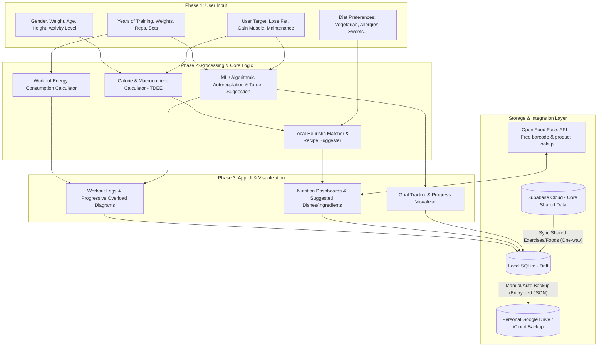
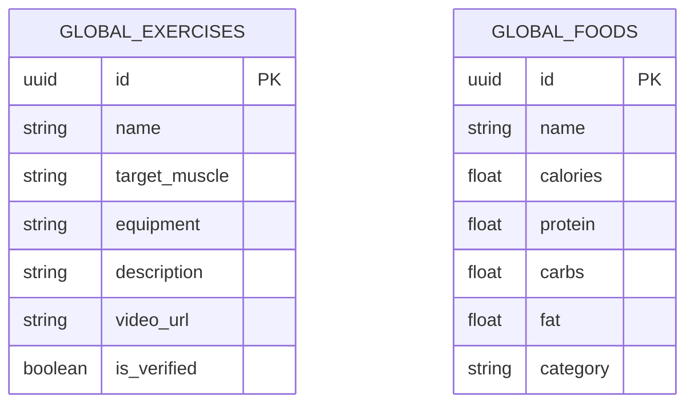
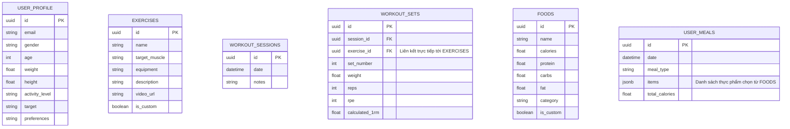

o lib/databases/app_database.dart source_gen:combining_builder                        
W app_database.g.dart must be included as a part directive in the input library     
  with:                                                                             
      part 'app_database.g.dart';                                                   
                                                                                    
Built with build_runner/aot in 23s with warnings; wrote 23 outputs. # Kế Hoạch Triển Khai: Gym & Nutrition Tracker App (Android/iOS)

Dự án này là một ứng dụng di động đa nền tảng (Android/iOS) hỗ trợ người dùng theo dõi quá trình tập luyện (Gym Tracker) và đề xuất dinh dưỡng cá nhân hóa (Nutrition Suggestion) sử dụng Trí tuệ Nhân tạo (AI/ML). 

Hệ thống sẽ ghi nhận lịch sử tập luyện, tính toán năng lượng tiêu hao, áp dụng phương pháp Tăng tiến Tải trọng (Progressive Overload) và Tự điều chỉnh (Autoregulation) để đề xuất mục tiêu tiếp theo. Song song đó, dựa vào thông tin thể trạng và sở thích ẩm thực (chay, ngọt, dị ứng...), ứng dụng sẽ đề xuất thực đơn và nguyên liệu nấu ăn phù hợp.

## Các Quyết Định Thiết Kế Đã Thống Nhất

> [!IMPORTANT]
> **1. Framework di động:** Sử dụng **Flutter** (Dart).
> **2. Cơ sở dữ liệu Cloud:** Sử dụng **Supabase** (Gói Free).
> **3. Kiến trúc Cơ sở dữ liệu (Database Architecture):** Áp dụng mô hình **Hybrid Decentralized (Shared Cloud + Local Personal)**:
>    - **Supabase Cloud (Gói Free ~500MB):** Chỉ lưu trữ dữ liệu chung phổ biến nhất (danh mục bài tập chuẩn phổ biến, thực phẩm cơ bản phổ biến, cấu hình hệ thống). 
>    - **Phương án dự phòng tràn dung lượng Cloud DB:** Nếu dữ liệu danh mục chung phình to, Supabase sẽ chỉ lưu giữ các mục phổ biến nhất. Các mục ít dùng được truy vấn từ API bên ngoài (Open Food Facts) sẽ chỉ được tải và lưu trữ cục bộ trên thiết bị của người dùng dưới dạng custom food/exercise trong bảng local `FOODS`/`EXERCISES` (với cờ `is_custom = true`), không đồng bộ ngược lại Cloud.
>    - **Local DB (SQLite - Drift):** Lưu trữ toàn bộ thông tin cá nhân của người dùng (lịch sử tập, nhật ký ăn uống, thể trạng, bài tập/món ăn tự custom). Đảm bảo bảo mật và hoạt động offline hoàn toàn.
>    - **Giải pháp Sao lưu (Backup):** Người dùng có thể xuất file sao lưu (mã hóa JSON/SQLite) đồng bộ lên tài khoản **Google Drive / iCloud** cá nhân của họ.
> **4. Phương án Dinh dưỡng & Gợi ý món ăn:** Hoàn toàn **MIỄN PHÍ**. Sử dụng **Thuật toán Heuristic Đa dạng hóa (Diverse Heuristic Matcher)** chạy cục bộ (kết hợp cơ chế phạt tần suất món ăn và lựa chọn ngẫu nhiên có trọng số Softmax) + **Open Food Facts API** (miễn phí, không cần API Key) để đảm bảo thực đơn gợi ý phong phú, không lặp đi lặp lại.
> **5. Thuật toán ML Autoregulation:** Tích hợp mô hình toán học khách quan (Volume Load, Drop-off rate, ACWR, APRE) không sử dụng chỉ số RPE. Sử dụng mô hình **Hồi quy Tuyến tính có phạt (Ridge Regression)** huấn luyện và dự báo trực tiếp cục bộ trên điện thoại bằng Dart nhằm tối ưu hiệu năng và bảo mật, kèm lộ trình nâng cấp lên XGBoost trong tương lai.

---

## Kiến trúc Hệ thống & Luồng Dữ liệu

---

## Proposed Changes

Vì dự án hiện tại mới chỉ có thư mục trống và file `README.md`, chúng tôi sẽ khởi tạo dự án di động theo lựa chọn của bạn. Dưới đây là cấu trúc cơ sở dữ liệu đề xuất và kế hoạch chi tiết cho các thành phần cốt lõi.

### 1. Database Schema Design (Hybrid: Supabase Shared + Local Personal)

Để hiện thực hóa ý tưởng của bạn, cơ sở dữ liệu được chia làm hai phần rõ rệt:

#### A. Supabase Cloud Database (Lưu trữ dùng chung cho tất cả Users)
Chỉ lưu trữ các dữ liệu tĩnh, cấu hình chung hoặc các bài tập/thực phẩm chuẩn đã được kiểm duyệt có mức độ phổ biến cao. Dung lượng lưu trữ cực kỳ tối giản (ước tính < 10MB cho dữ liệu khởi tạo, tránh nguy cơ tràn dung lượng free tier 500MB).
- **`GLOBAL_EXERCISES`**: Danh mục bài tập chuẩn phổ biến.
- **`GLOBAL_FOODS`**: Danh mục thực phẩm/nguyên liệu phổ biến nhất.

#### B. Local Database (SQLite - Drift, Lưu trữ riêng tư trên máy User)
Lưu toàn bộ nhật ký tập luyện, dinh dưỡng, thể trạng và các tùy chỉnh cá nhân. Để tối ưu hóa thiết kế cơ sở dữ liệu quan hệ (đảm bảo khóa ngoại chuẩn xác và giảm thiểu độ phức tạp SQL), chúng ta sẽ gộp dữ liệu dùng chung (Global) và tự tạo (Custom) vào chung một bảng ở local, phân biệt bằng cờ `is_custom`:
- **`USER_PROFILE`**: Thể trạng hiện tại, mục tiêu, sở thích ăn uống.
- **`EXERCISES`**: Lưu toàn bộ bài tập (bài tập đồng bộ từ Supabase có `is_custom = false`, bài tập user tự tạo có `is_custom = true`).
- **`WORKOUT_SESSIONS`**: Các buổi tập của user.
- **`WORKOUT_SETS`**: Chi tiết các set tập trong mỗi buổi (khóa ngoại `exercise_id` liên kết trực tiếp đến bảng `EXERCISES`).
- **`FOODS`**: Lưu toàn bộ thực phẩm (đồng bộ từ Supabase có `is_custom = false`, user tự tạo hoặc được cache từ Open Food Facts khi tìm kiếm có `is_custom = true`).
- **`USER_MEALS`**: Nhật ký ăn uống hằng ngày (liên kết trực tiếp đến bảng `FOODS`).

---

### 2. Chi tiết Thuật toán & Trí tuệ Nhân tạo (ML/AI)

#### A. Autoregulation & Progression (Tập luyện)
Hệ thống Tự điều chỉnh tải trọng (Autoregulation) sẽ hoạt động dựa trên các chỉ số hiệu suất khách quan (Objective) thay vì cảm nhận chủ quan (RPE).

##### 1. Các Biến Số Cơ Bản (Basic Variables)
Mỗi buổi tập t cho một bài tập cụ thể bao gồm các biến sau:
- Weight_t: Mức tạ sử dụng tại buổi t (kg).
- Sets: Tổng số set được chỉ định (ví dụ: 3 hoặc 4 set).
- Reps_target: Số rep mục tiêu mỗi set.
- Reps_actual(s): Số rep thực tế hoàn thành ở set s (s chạy từ 1 đến Sets).
- Step_W: Bước tăng/giảm tạ tối thiểu của ứng dụng (mặc định là 2.5 kg).
- DaysRest_t: Số ngày nghỉ kể từ buổi tập gần nhất của nhóm cơ này.

##### 2. Kỹ Nghệ Đặc Trưng (Feature Engineering)
Độ mệt mỏi sinh lý và trạng thái sẵn sàng của cơ bắp/thần kinh trung ương được trích xuất qua các công thức dạng chữ:
- **Volume Load (Khối lượng tải tích lũy):**
  Volume_t = Tổng_các_set_s(Weight_t * Reps_actual(s))
- **Rep Drop-off Rate (Tỷ lệ sụt giảm Rep):** Đo lường sự suy kiệt sức bền trong buổi tập (sụt giảm giữa set đầu và set cuối).
  DropOff_t = (Reps_actual(set_1) - Reps_actual(set_cuối)) / Reps_actual(set_1)
- **Acute:Chronic Workload Ratio (ACWR - Tỷ lệ tải cấp tính/mãn tính):** Dùng để phát hiện quá tải lâu dài.
  ACWR_t = Volume_t / (Trung bình cộng Volume của 4 buổi tập trước đó)

##### 3. Thuật Toán Dựa Trên Luật (Rule-Based APRE Protocol - Giai đoạn Cold Start)
Trong giai đoạn đầu khi chưa đủ dữ liệu huấn luyện ML, hệ thống sử dụng giao thức **APRE (Autoregulating Progressive Resistance Exercise)**. Set cuối cùng (set thứ S) sẽ được chỉ định là set **AMRAP (Cố gắng thực hiện tối đa số Rep có thể)**.
- Độ lệch số Rep thực tế so với mục tiêu ở set cuối:
  Delta_Reps = Reps_actual(set_cuối) - Reps_target
- Cập nhật mức tạ cho buổi tiếp theo (Weight_t+1):
  * Nếu Delta_Reps >= 3: Weight_t+1 = Weight_t + (2 * Step_W)  *(Tăng 5 kg)*
  * Nếu Delta_Reps từ 1 đến 2: Weight_t+1 = Weight_t + Step_W  *(Tăng 2.5 kg)*
  * Nếu Delta_Reps từ -1 đến 0: Weight_t+1 = Weight_t  *(Giữ nguyên tạ)*
  * Nếu Delta_Reps <= -2: Weight_t+1 = Weight_t - Step_W  *(Giảm 2.5 kg)*
- **Quy tắc Deload đặc biệt:** Nếu DaysRest_t > 14 (người dùng nghỉ tập nhóm cơ này quá 2 tuần), hệ thống tự động giảm 10% mức tạ để đảm bảo an toàn, tránh chấn thương:
  Weight_t+1 = Weight_t * 0.9

##### 4. Mô Hình Học Máy (Machine Learning Regression)
Khi cơ sở dữ liệu local tích lũy đủ lịch sử tập luyện của người dùng (từ hệ thống Rule-based, tối thiểu 10-20 buổi tập), hệ thống sẽ kích hoạt mô hình ML để dự đoán mức tạ tối ưu cho buổi tiếp theo.
- **Mô hình cốt lõi:** Sử dụng **Hồi quy Ridge (Ridge Regression)** - một mô hình hồi quy tuyến tính có thành phần phạt L2 chống quá khớp (overfitting) rất tốt cho tập dữ liệu nhỏ của cá nhân.
- **Vector Đặc Trưng (Input Features):**
  X_t = [ Weight_t, Tổng_số_Reps_thực_tế, DropOff_t, ACWR_t, DaysRest_buổi_t+1 ]
- **Công thức dự đoán mức tạ:**
  Weight_t+1_dự_đoán = b0 + b1 * Weight_t + b2 * Tổng_số_Reps_thực_tế + b3 * DropOff_t + b4 * ACWR_t + b5 * DaysRest_buổi_t+1
  *(Trong đó b0, b1, b2, b3, b4, b5 là các hệ số hồi quy được mô hình học máy tự động tối ưu hóa)*
- **Hàm Mục Tiêu (Objective Function - Ridge):** Tìm bộ hệ số b tối thiểu hóa tổng sai số bình phương giữa mức tạ dự đoán và mức tạ tối ưu thực tế (labeled ở buổi t+1), cộng thêm thành phần phạt (alpha * bình_phương_độ_dài_vecto_b).
- **Phương án triển khai trên Flutter:**
  *   *Huấn luyện và Dự đoán Cục bộ (Local Training & Inference):* Do mô hình Ridge Regression có nghiệm toán học dạng đóng (Closed-form solution) rất đơn giản thông qua các phép toán ma trận cơ bản (nhân, chuyển vị, nghịch đảo ma trận kích thước 6x6), thuật toán sẽ được lập trình bằng Dart thuần túy trực tiếp trên thiết bị của người dùng. Quá trình chạy mất chưa tới 1 mili-giây, hoàn toàn offline, tiết kiệm pin tối đa và bảo vệ quyền riêng tư tuyệt đối.
  
> [!NOTE]
> **Lộ trình nâng cấp tương lai (XGBoost):**
> Khi ứng dụng đã trưởng thành và tích lũy được lượng lớn dữ liệu tập luyện thô ẩn danh (anonymized) từ cộng đồng, ta có thể xây dựng mô hình phi tuyến tính **XGBoost** trên Cloud. Mô hình này sau khi được huấn luyện xong sẽ được đóng gói dưới dạng **TFLite** hoặc **ONNX** và tải về ứng dụng di động của người dùng để thực hiện suy luận cục bộ (Local Inference) thay thế cho Ridge Regression, đảm bảo tính năng dự đoán cực kỳ chính xác mà vẫn bảo vệ quyền riêng tư và chạy offline tốt.

#### B. Nutrition & Recipe Recommendation (Dinh dưỡng)
*   **Bước 1: Tính toán TDEE (Total Daily Energy Expenditure - Tổng tiêu hao calo ngày):**
    *   Sử dụng công thức Mifflin-St Jeor để tính BMR (Basal Metabolic Rate - Lượng calo tiêu thụ tối thiểu khi nghỉ ngơi):
        - BMR (Nam) = (10 * Cân_nặng_kg) + (6.25 * Chiều_cao_cm) - (5 * Tuổi_năm) + 5
        - BMR (Nữ) = (10 * Cân_nặng_kg) + (6.25 * Chiều_cao_cm) - (5 * Tuổi_năm) - 161
    *   Tính TDEE = BMR * Chỉ_số_hoạt_động (chỉ số dao động từ 1.2 đến 1.9 tùy mức độ vận động trong ngày).
    *   Điều chỉnh lượng Calo theo mục tiêu:
        - Giảm cân (Lose Fat): Calo_mục_tiêu = TDEE - 500 kcal
        - Tăng cơ (Gain Muscle): Calo_mục_tiêu = TDEE + 300 kcal
*   **Bước 2: Phân bổ Macro Dinh dưỡng (Carb, Protein, Fat):**
    *   Protein: Từ 1.8g đến 2.2g trên mỗi kg cân nặng cơ thể (ví dụ: người 70kg cần 126g - 154g Protein).
    *   Fat: Từ 20% đến 25% tổng Calo_mục_tiêu (1g Fat giải phóng 9 kcal).
    *   Carbs: Phần calo còn lại sau khi trừ đi calo từ Protein và Fat sẽ dành cho Carbs (1g Carb giải phóng 4 kcal).
*   **Bước 3: Thuật toán Heuristic Đa dạng hóa (Diverse Heuristic Matcher - Không dùng API trả phí):**
    *   **Cơ chế tìm kiếm nguồn:** Kết hợp tìm kiếm ngoại tuyến từ CSDL local `FOODS` và gọi API miễn phí **Open Food Facts API** (không cần API Key) để quét mã vạch hoặc tra cứu dinh dưỡng sản phẩm.
    *   **Phân nhóm nguyên liệu (Categorization):** Phân mảnh danh mục món ăn thành các nhóm chức năng chính (Nguồn Carb, Nguồn Protein, Nguồn Fat tốt, Rau xanh/Xơ) để đảm bảo cơ cấu bữa ăn cân đối.
    *   **Bộ lọc cứng (Hard Filters):** Lọc bỏ lập tức các món ăn vi phạm quy tắc dị ứng hoặc chế độ ăn kiêng của người dùng.
    *   **Giải thuật Khớp Dinh dưỡng có Đa dạng hóa (Local Matcher Algorithm):**
        *   Tính toán vector dinh dưỡng còn thiếu trong ngày: Target_Vector = [Calo_cần_thêm, Protein_cần_thêm, Carbs_cần_thêm, Fat_cần_thêm].
        *   **Cơ chế Phạt tần suất (Frequency Penalty):** Duy trì bản đồ lịch sử ăn uống 7 ngày. Mỗi lần một nguyên liệu/món ăn được log hoặc gợi ý thành công, điểm phạt tần suất của nó sẽ tăng lên, cộng trực tiếp vào khoảng cách Euclidean giữa dinh dưỡng của món ăn và Target_Vector. Điều này giúp các món ít ăn hơn được ưu tiên gợi ý lên đầu.
        *   **Lựa chọn ngẫu nhiên có trọng số (Weighted Softmax Selection):** Thay vì luôn chọn món có độ khớp cao nhất tuyệt đối (gây lặp lại nhàm chán), thuật toán lấy TOP 5 món phù hợp nhất, chuẩn hóa độ khớp thành phân phối xác suất qua hàm Softmax, và sử dụng phép chọn ngẫu nhiên có trọng số để đưa ra thực đơn đa dạng mỗi ngày.
        *   Áp dụng giải thuật Knapsack Heuristic đơn giản để phối hợp các món được chọn thành thực đơn hoàn chỉnh khớp tối đa mục tiêu ngày.

---

## Kế hoạch Triển khai (Roadmap)

### Giai đoạn 1: Khởi tạo và Thiết lập Cơ sở dữ liệu (Tuần 1)
- [ ] Khởi tạo dự án Di động bằng Flutter.
- [ ] Thiết lập tài khoản Cloud Supabase và khởi tạo database tables chung.
- [ ] Cài đặt SQLite cục bộ qua thư viện Drift và cấu hình đồng bộ tải dữ liệu dùng chung (Cloud -> Local cache).
- [ ] Thiết lập tính năng Backup/Restore dữ liệu cá nhân qua tài khoản Google Drive / iCloud của người dùng.
- [ ] Seed cơ sở dữ liệu bài tập và thực phẩm dùng chung cốt lõi.

### Giai đoạn 2: Phát triển Module Tập luyện & Biểu đồ (Tuần 2)
- [ ] Xây dựng UI ghi log tập luyện: nhập Set, Rep, Weight, RPE cho từng bài tập.
- [ ] Phát triển công thức tính Calo tiêu hao dựa trên METs (Metabolic Equivalent of Task) của các bài tập gym.
- [ ] Vẽ biểu đồ tiến trình (Diagram) biểu diễn sự tăng trưởng của Estimated 1RM và Tổng Volume tập luyện theo thời gian.
- [ ] Tích hợp khung thuật toán Autoregulation đề xuất mức tạ/rep cho buổi tập tiếp theo.

### Giai đoạn 3: Phát triển Module Dinh dưỡng & Thuật toán Gợi ý (Tuần 3)
- [ ] Thiết lập màn hình khảo sát thể trạng (Gender, Weight, Age, Height, Activity) để tính toán tự động TDEE & Macro.
- [ ] Phát triển màn hình cấu hình sở thích (Preferences): ăn chay, hạn chế ngọt, dị ứng gluten/hải sản...
- [ ] Tích hợp **Open Food Facts API** (miễn phí, không key) để tìm kiếm thực phẩm trực tuyến và quét mã vạch.
- [ ] Phát triển thuật toán gợi ý cục bộ (Heuristic Matcher) để tự động đề xuất, phối món ăn dựa trên lượng Calo/Macro còn lại trong ngày của người dùng và sở thích ăn uống.

### Giai đoạn 4: Đánh bóng UI/UX & Kiểm thử (Tuần 4)
- [ ] Tối ưu hóa giao diện với thiết kế sang trọng (vibrant colors, dark mode, smooth micro-animations).
- [ ] Kiểm thử việc đọc ghi dữ liệu cục bộ hoàn toàn ngoại tuyến và cơ chế tải dữ liệu dùng chung khi trực tuyến.
- [ ] Kiểm thử chức năng sao lưu/khôi phục dữ liệu cá nhân (Backup/Restore).
- [ ] Đo lường hiệu năng và xuất bản bản thử nghiệm (TestFlight cho iOS / Internal Test cho Android).

---

## Verification Plan
### Kiểm thử Tự động (Automated Tests)
*   **Unit Tests:** Kiểm tra các công thức toán học cốt lõi: tính BMR, TDEE, Estimated 1RM, và khung đề xuất Progressive Overload.
*   **Integration Tests:** Đảm bảo dữ liệu ghi từ màn hình Workout log lưu đúng vào local SQLite và kiểm thử tính năng Backup/Restore lên Drive/iCloud cá nhân hoạt động chuẩn xác.

### Kiểm thử Thủ công (Manual Verification)
*   Mô phỏng người dùng nhập lịch sử tập luyện của 3 buổi liên tục để xác nhận thuật toán Autoregulation đề xuất tạ tăng dần chính xác.
*   Nhập các mục tiêu Calo/Macro và thiết lập chế độ ăn (ví dụ: còn thiếu 500 kcal, 40g Protein, ăn chay, dị ứng lạc) để kiểm chứng thuật toán gợi ý cục bộ đề xuất đúng thực đơn phù hợp và không vi phạm bộ lọc.
